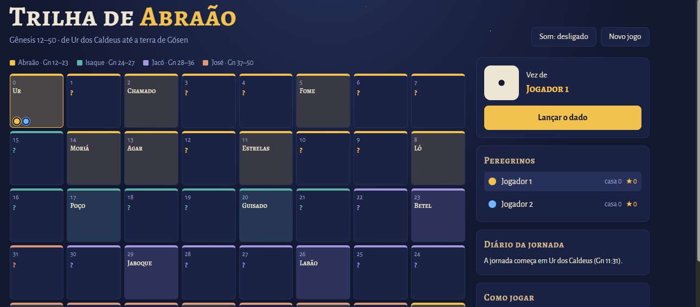

Gosto de ensinar e de programar, e os jogos são onde as duas coisas se encontram. Cada um é feito para ser **simples de abrir** (basta um link, sem instalar nada), **gratuito** e **bom para jogar em grupo**: em casa, na igreja ou na sala de aula.

## 🧭 Trilha de Abraão

[{.img-fluid .rounded fig-alt="Captura de tela do tabuleiro da Trilha de Abraão, com 40 casas em serpentina"}](https://davimatfacil.github.io/trilha-de-abraao/){target="_blank"}

Jogo de trilha bíblico sobre **Gênesis 12–50**. Os jogadores partem de Ur dos Caldeus e caminham até a terra de Gósen, passando pelas histórias de Abraão, Isaque, Jacó e José.

- 👥 De 1 a 4 jogadores no mesmo aparelho, no computador ou no celular
- 🎲 Trilha de 40 casas, com perguntas de múltipla escolha e episódios de Gênesis que fazem avançar, voltar, perder a vez ou ganhar estrelas
- 📖 Toda pergunta mostra a referência bíblica para leitura
- 🏆 Vence quem tiver mais estrelas ao final da jornada

[▶ Jogar agora](https://davimatfacil.github.io/trilha-de-abraao/){.btn .btn-success .btn-lg target="_blank"}
[Código-fonte](https://github.com/davimatfacil/trilha-de-abraao){.btn .btn-outline-secondary .btn-lg target="_blank"}

::: {.callout-note collapse="true"}
## Como foi feito

É um único arquivo `index.html` com HTML, CSS e JavaScript puro, sem frameworks, servidor ou banco de dados. As perguntas e os episódios ficam separados da lógica do jogo, então dá para criar uma trilha de outro livro trocando só esses dados. O som é sintetizado no próprio navegador. Está disponível sob licença MIT.
:::

## 🚧 Próximos jogos

Outros jogos estão a caminho. Se você tem uma **sugestão de pergunta, uma ideia de jogo** ou quer usar algum deles com sua turma ou grupo, escreva para mim.

[Enviar mensagem](../contato.html){.btn .btn-primary}
